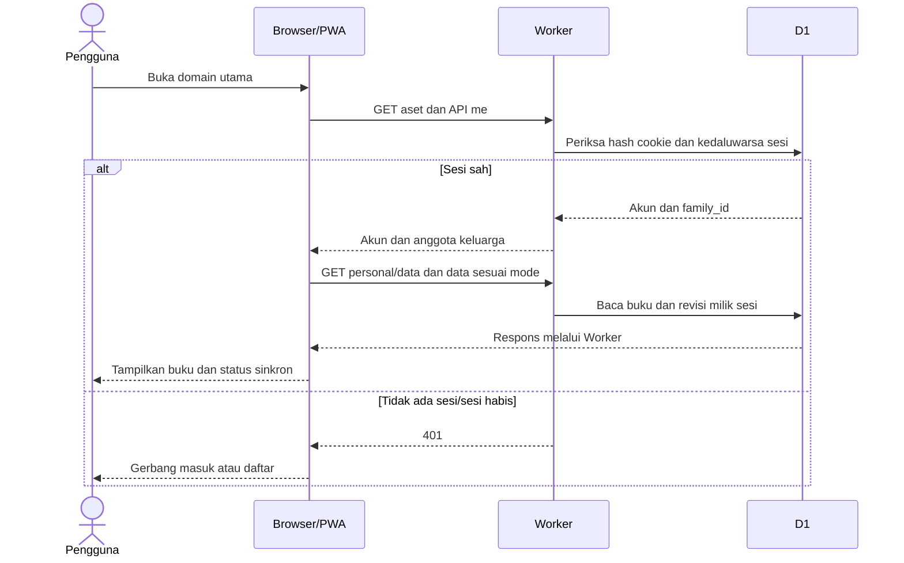
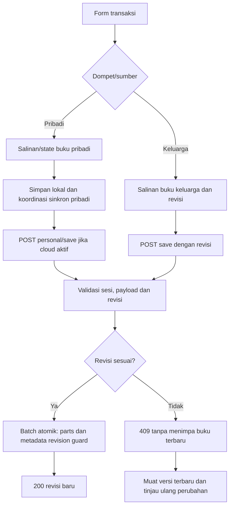
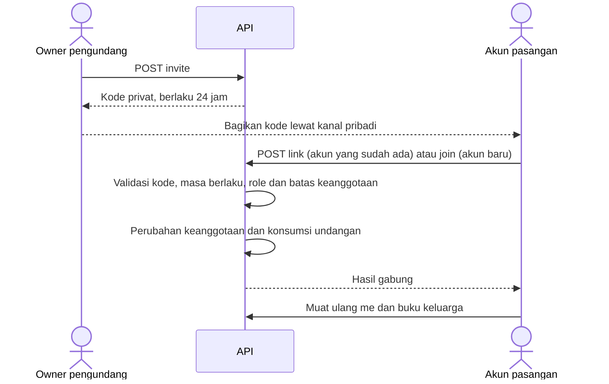
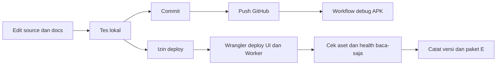

# Alur aplikasi dan data KantongKita

Diperiksa terhadap source 23 Oktober 2026. Diagram adalah alur logis: nama fungsi detail dapat berubah. Referensi: [infrastruktur](infrastruktur.md), [panduan](panduan.md), [operasional](operasional.md).

## 1. Buka aplikasi dan muat akun

LocalStorage menyimpan state/profil perangkat. Sesi cloud tidak dianggap sah hanya karena ada data lokal. Jika keluarga belum berhasil dimuat, UI tidak boleh mengganti sumber dengan data pribadi diam-diam. Tampilan gabungan adalah hasil presentasi, bukan payload buku yang boleh disimpan atau diekspor.

## 2. Daftar dan login

1. Pengguna membuat username/password; email pemulihan wajib bila layanan email aktif. `POST /api/family/activate` membuat keluarga baru dan akun owner. Pendaftaran terbuka, bukan aktivasi satu keluarga global.
2. Server menormalisasi username, memvalidasi password, membuat hash password dan recovery code. Recovery code dikembalikan untuk disimpan privat, bukan ditempel di dokumentasi.
3. Bila email disediakan, server berusaha mengirim verifikasi. Status kirim bukan jaminan pesan tiba di inbox.
4. Pengguna login melalui `POST /api/family/login`; server memeriksa password, menyimpan hash token sesi, lalu mengatur cookie 7 hari.
5. `GET /api/family/me` menjadi dasar status akun/anggota. Daftar tidak boleh didokumentasikan sebagai otomatis memiliki cookie login: endpoint daftar mengembalikan recovery/email status.
6. Logout `POST /api/family/logout` menghapus sesi terkait dan mengosongkan cookie.

## 3. Catat transaksi dan simpan

Pengguna memilih dompet/sumber. Buku pribadi dan keluarga tetap berbeda meskipun dashboard dapat menampilkan keduanya. Transfer memakai referensi dompet yang konsisten dalam buku; validasi hitungan tidak boleh diganti dengan manipulasi label UI.

### Buku pribadi

`App.saveAndRender()` menangani persistensi dan render; integrasi akun memakai `personal/save` dengan revisi pribadi. `K.simpanPribadi` membedakan `ok`, `bentrok`, `keluar`, `gagal`, atau mode lokal `pribadi`. Menyimpan lokal **tidak berarti** sudah tersimpan cloud. Bila jaringan/sesi gagal, perhatikan status UI dan lindungi perubahan lokal melalui backup sebelum hapus data situs atau pindah perangkat.

### Buku keluarga

`Buku.simpan()` menolak payload hasil gabungan (penanda `_sumber`/`_id`), akun tidak sesuai, atau proses sibuk/belum dimuat. Buku lengkap dikirim ke `/save`; jika 409, UI meminta tutup formulir, muat ulang keluarga dan coba lagi. Tidak ada klaim auto-merge transaksi yang berbenturan.

### Backend penyimpanan

Backend memvalidasi revisi bilangan bulat aman, menyusun JSON parts dan mengerjakan perubahan dalam batch atomik dengan revision guard. Update revisi akhir hanya sah untuk revisi yang diharapkan. Stale write tidak boleh menghapus parts buku terbaru. Tes SQLite lokal meliputi race/rollback; itu bukan bukti uji beban D1 produksi.

## 4. Undang/gabung pasangan dan privasi

`link` dan `join` bukan operasi identik: pertama untuk owner akun yang sudah ada, kedua untuk pembuatan akun pasangan. Backend memeriksa kondisi agar perpindahan tidak membuat buku keluarga lama tidak terjangkau; jangan menyiasati penolakan dengan edit SQL manual.

Buku pribadi tetap terikat user. **Tidak ada impor seluruh riwayat pribadi otomatis.** Fitur bagikan data lama meminta pemilihan dompet secara eksplisit. Transaksi dan kategori terkait disalin, sumber asli tetap, transfer harus memilih kedua dompet. Target, anggaran, langganan dan gambar struk tidak ikut proses salin lama itu. ID deterministik mengurangi duplikasi saat pilihan yang sama diulang.

## 5. Pemulihan akses

### Email

- `email/request-reset`: respons publik generik untuk mengurangi pengungkapan akun; hanya email terverifikasi yang memenuhi syarat reset.
- Server membuat token hash dan mengirim link lewat Resend. Token asli berada pada fragment `#reset=...` atau `#verify=...`, bukan query string HTTP.
- Halaman `/akun-email` membaca fragment dan mengirim token ke `email/reset` atau `email/verify` melalui POST.
- Verifikasi berlaku 24 jam; reset 30 menit; satu kali pakai. Reset password membatalkan sesi akun. Cooldown dan rate limit tetap berlaku.
- Pesan sukses permintaan reset tidak membuktikan email ada/terkirim. Lihat spam dan status provider secara privat.

### Recovery code

`POST recover` memeriksa username dan hash kode, mengganti password serta recovery code, lalu membatalkan sesi dan token email akun. Kode lama tidak dipakai ulang. Simpan kode baru di lokasi privat di luar repo.

## 6. Ekspor, backup dan restore

| Aksi | Sumber/hasil | Batas |
|---|---|---|
| CSV | Pilih buku pribadi atau keluarga | Bukan restore penuh semua fitur |
| Excel | XLSX lokal dengan angka/tanggal terstruktur | Bukan cadangan database/autentikasi |
| JSON | Satu buku, ID asli, seluruh periode | Format baru `kantongkita` v1; format lama `savingduit` v1 diterima |
| Restore JSON | Pilih target dan konfirmasi penggantian | Validasi skema, ID, referensi, sumber dan akun/revisi |
| Dump D1 | Backup operator server | Berisi material sensitif, bukan untuk paket source |

Sumber ekspor tidak mengambil `Buku.data()` gabungan. Ekspor keluarga memerlukan akun yang sesuai dan buku termuat/tidak sibuk; jika tidak tersedia harus menolak, bukan mengekspor pribadi sebagai keluarga. Restore keluarga memakai simpan revision-safe; restore pribadi mengikuti persistensi pribadi. Reset dari pengaturan adalah reset pribadi, bukan izin menghapus buku keluarga.

Integrasi Google Drive di dalam aplikasi masih dikunci. Upload ZIP source melalui browser adalah pekerjaan terpisah, bukan bukti integrasi Drive aktif. Pada pemeriksaan sebelumnya upload tersebut terhalang konflik ekstensi; tidak boleh dianggap sudah berhasil.

## 7. Siklus rilis

Push, deploy, migrasi DB dan pembuatan paket E adalah tindakan berbeda. Migrasi memerlukan backup dan persetujuan tersendiri. Diagram tidak menyatakan semua tahap otomatis. Dokumen baru ini tidak mengubah perhitungan, autentikasi atau data produksi.

## 8. Referensi endpoint ringkas

Semua path berikut berawalan `/api/family/`.

| Endpoint | Metode | Keperluan |
|---|---|---|
| activate, join, login, recover | POST | Daftar, gabung baru, masuk, recovery code |
| me | GET | Sesi dan anggota |
| logout, invite, link | POST | Keluar, undangan, gabung akun lama |
| data, personal/data | GET | Buku keluarga/pribadi dengan revisi |
| save, personal/save | POST | Simpan buku lengkap |
| email/config | GET | Kesiapan konfigurasi email |
| email/status | GET | Email akun/sudah diverifikasi |
| email/resend | POST | Kirim ulang verifikasi |
| email/request-reset, email/reset, email/verify | POST | Pemulihan/verifikasi |
| transaction | POST | Legacy ditutup 410 |

Lihat handler aktual sebelum membangun klien lain. Tabel ini bukan kontrak OpenAPI lengkap dan tidak mencantumkan semua field payload.

## Presentasi tanggal dan modal — v54

Tanggal transaksi tersimpan sebagai YYYY-MM-DD, tidak diganti ketika label relatif diperbaiki. `U.relativeDate` menghitung tanggal transaksi minus hari ini: -1 Kemarin,0 Hari ini,+1 Besok,-2 sampai -6 N hari lalu; lainnya tanggal lengkap. Hari ini mengikuti tanggal lokal perangkat, bukan pemaksaan zona waktu server. Modal mengikuti tinggi/offset VisualViewport; hanya body form yang scroll, head/footer tetap terlihat. Lihat [catatan rilis](rilis-v54.md) dan [sistem desain](design-system.md).
