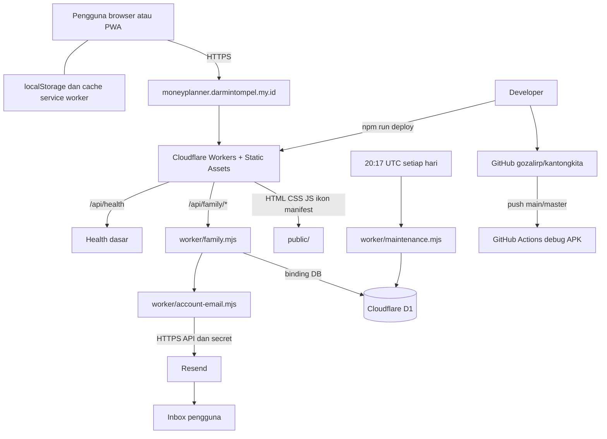

# Infrastruktur KantongKita

Dokumen teknis dan serah-terima, diperiksa terhadap source pada 23 Oktober 2026. Baca bersama [alur aplikasi](alur-aplikasi.md), [operasional](operasional.md), dan [database](database.md). Ini inventaris konfigurasi, bukan audit keamanan baru atau jaminan uptime.

## 1. Gambaran sistem

KantongKita adalah aplikasi pencatatan keuangan vanilla HTML/CSS/JavaScript dengan PWA. Frontend dan backend terpisah folder tetapi berada dalam satu repository dan satu deployment Cloudflare Worker. Tidak ada server VPS, container, Redis, antrean, atau layanan React yang dikonfigurasi di project ini.

Diagram menggambarkan hubungan logis, bukan bukti letak fisik data atau routing internal Cloudflare. Browser mengakses API, bukan D1 langsung. GitHub Actions yang ada membangun APK; tidak ada deployment Worker otomatis di workflow tersebut.

## 2. Inventaris dan konfigurasi

| Komponen | Konfigurasi aktual | Fungsi/catatan |
|---|---|---|
| Repo | `https://github.com/gozalirp/kantongkita` | Source, tes, docs dan workflow APK |
| Domain aplikasi | `https://moneyplanner.darmintompel.my.id` | Origin utama, cookie sesi dan tautan email |
| Worker | `savingduit` | Identifier lama sengaja dipertahankan |
| Alamat workers.dev | `https://savingduit.gozalirp.workers.dev` | Bukan origin utama; jangan menganggap sesi berbagi lintas host |
| Entry backend | `worker/worker.js` | API router, static asset fallback, scheduled handler |
| Static assets | `public/` | Hanya folder ini menjadi aset publik |
| D1 | `savingduit-db`, binding `DB` | Akun, sesi, buku pribadi/keluarga, token dan limiter |
| Compatibility date | `2024-01-01` | Sesuai `wrangler.toml`, bukan tanggal rilis aplikasi |
| `FAMILY_ENABLED` | `true` | Bila false API keluarga mengembalikan 503; bukan rollback DB |
| `APP_ORIGIN` | Domain utama di atas | Pembuatan link dan pemeriksaan kesiapan email |
| `EMAIL_FROM` | `KantongKita <akun@mail.darmintompel.my.id>` | Sender Resend; verifikasi DNS/provider lihat panduan email |
| Secret | `RESEND_API_KEY` | Disimpan di Wrangler secret, jangan di Git/arsip |
| Cron | `17 20 * * *` UTC | 03:17 WIB hari berikutnya |
| SW source terkini | `kantongkita-v54` | Nama versi cache, bukan versi database |

Identifier D1 tersedia di `wrangler.toml`; tidak perlu menyalin credential, cookie, recovery code, token email atau dump ke dokumen. Pengelola memerlukan akses Cloudflare (Worker/D1/secrets), GitHub, DNS/domain, dan Resend sesuai kewenangannya. Hak akses paling minimal dan MFA harus dikelola di masing-masing layanan; tidak diverifikasi oleh dokumen ini.

## 3. Batas folder dan tanggung jawab

- `public/js/app.js`: bootstrap, render/navigasi, persistensi lokal dan koordinasi simpan.
- `public/js/store.js`, `util.js`: model, perhitungan dan utilitas.
- `public/js/views.js`: formulir, dashboard, kalender dan ekspor/impor.
- `public/js/buku-gabungan.js`: sumber pribadi/keluarga, tampilan gabungan dan operasi buku bersama.
- `public/js/keluarga-mode.js`, `uiGerbang.js`: akun, sesi dan integrasi cloud.
- `public/js/excel.js`: pembentukan XLSX di perangkat tanpa CDN.
- `public/sw.js`, `manifest.json`: PWA dan cache aset; cache bukan backup buku.
- `worker/family.mjs`, `family-security.mjs`: API, otorisasi, sesi, password dan penyimpanan buku.
- `worker/account-email.mjs`: token verifikasi/reset serta pengiriman Resend.
- `worker/maintenance.mjs`: penghapusan terbatas data autentikasi kedaluwarsa.
- `worker/migrations/`: migrasi SQL terpisah dari deploy.
- `worker/server.js`: server Node lama, bukan arsitektur login produksi.

## 4. Data dan trust boundary

| Lokasi | Isi | Batas penting |
|---|---|---|
| Browser localStorage | Profil dan arsip pribadi perangkat, preferensi, state lokal | Hapus data situs bisa menghilangkan data yang belum dibackup/disinkron |
| D1 `personal_data/parts` | Buku pribadi berdasarkan `user_id` | Tidak otomatis dibagikan saat bergabung keluarga |
| D1 `family_data/parts` | Buku bersama berdasarkan `family_id` | Anggota keluarga yang sah dapat mengakses |
| D1 autentikasi | User, sesi hash, undangan hash, email dan token hash | Akses backend saja; jangan dibawa ke paket source |
| Cache PWA | Aset aplikasi | Tidak membuktikan login/sinkronisasi dapat bekerja offline |
| Resend | Alamat tujuan dan isi pesan verifikasi/reset | Provider eksternal, bukan tempat buku keuangan disimpan |
| ZIP source E | Source, docs, manifest hash | Tidak berisi buku pengguna atau rahasia |

Isi buku berupa JSON terpotong setiap 90.000 karakter, bukan tabel transaksi SQL ternormalisasi. Revision guard menghindari penimpaan dari klien yang tertinggal. Skema dan relasi rinci: [database.md](database.md).

## 5. Keamanan yang diimplementasikan dan batasnya

- HTTPS, cookie `__Host-sd_session` dengan `HttpOnly; Secure; SameSite=Strict; Path=/`; umur sesi 7 hari.
- Token acak 32 byte dan hash SHA-256 dalam DB. Password PBKDF2-SHA256 100.000 iterasi dengan salt acak, bukan plaintext. Batas runtime dan kompromi terhadap pedoman iterasi lebih tinggi dicatat di source; bukan klaim audit kriptografi.
- POST keluarga membandingkan header Origin dengan origin URL request. Mengganti domain memerlukan pemeriksaan alur login/email, bukan sekadar mengganti label.
- POST dibatasi 500.000 karakter; limiter 15 menit per hash IP+endpoint: 10 untuk endpoint autentikasi/pemulihan tertentu, 120 lainnya. Bukan proteksi DDoS menyeluruh.
- Otorisasi buku diturunkan dari sesi server, bukan ID keluarga pilihan browser.
- `/api/sync` diblokir 503; `/api/family/transaction` lama ditutup 410. Kode legacy yang masih ada bukan jalur aktif.
- Tidak ada klaim end-to-end encryption. Operator DB yang berwenang tetap memiliki akses administratif. Profil/kunci UI lokal bukan pengganti otorisasi backend.

## 6. PWA, APK dan kompatibilitas

PWA domain utama adalah jalur penggunaan yang disarankan. Workflow APK memakai Node 20, JDK 21 dan Capacitor, menghasilkan **debug APK**, bukan bukti release bertanda tangan Play Store. `appId` tetap `com.savingduit.app`. Konfigurasi workflow belum memiliki `server.url` produksi, sehingga keberhasilan build tidak membuktikan API relatif/login cloud bekerja di APK.

Brand baru tidak mengubah resource Cloudflare, storage key `savingduit.*`, cookie sesi, ID Android atau kompatibilitas backup lama. Migrasi identifier/domain harus direncanakan terpisah dengan backup dan uji kompatibilitas.

## 7. Status dan kapasitas yang belum dipastikan

Riwayat rilis ikon hijau: Worker `afa976b3-a9b1-4c8d-940f-5be11096672c`, SW v50, commit fitur `fe9eb7f`. Kelima aset berubah terverifikasi identik dengan lokal dan health 200 saat rollout. Angka tersebut adalah bukti point-in-time, bukan pemantauan berkelanjutan.

Belum ada SLO/SLA aplikasi yang ditetapkan, uji beban produksi, verifikasi lokasi residensi data, jadwal backup eksternal otomatis, atau pemantauan alarm end-to-end yang dibuktikan dalam repo. Tarif/kuota mengikuti akun Cloudflare/Resend/GitHub, bukan angka tetap di dokumen. Pemeriksaan HP fisik, visual Excel, pengiriman email nyata, produksi dua akun/concurrency dan eksekusi cron pertama belum dibuktikan di sesi ini.

Status deployment terkini: [rilis v54](rilis-v54.md). Resource/domain/D1/cron tidak berubah pada rilis frontend ini.
